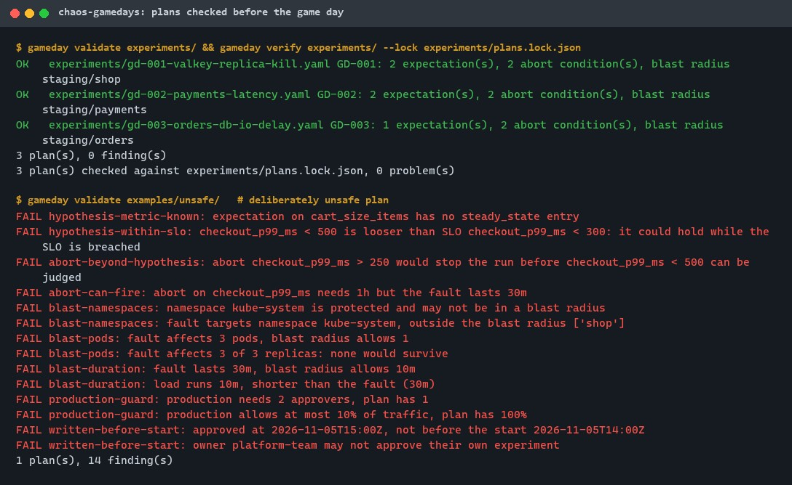
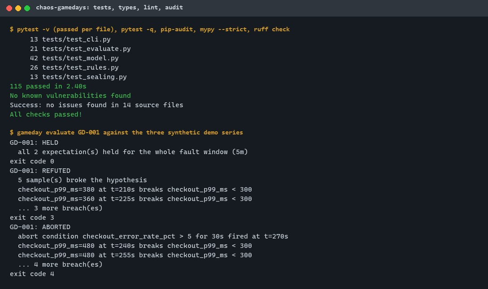
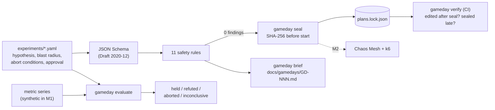
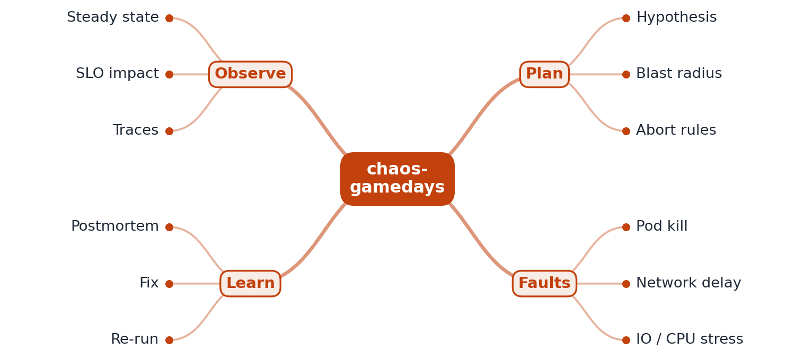

# chaos-gamedays

[](https://github.com/EquinoxWN/chaos-gamedays/actions/workflows/ci.yml)


> Find out your system survives failure before your customers do: planned failure drills closed with blameless postmortems.

Part of my **DevOps and Cloud** list · Python / YAML

M1 is the planning half of a game day: every experiment is a YAML plan with a falsifiable
hypothesis, a blast radius and abort conditions, checked by a JSON Schema and eleven safety rules,
sealed (SHA-256) before its scheduled start, and judged against a metric series. M1 injects no
faults and touches no cluster; Chaos Mesh and k6 come in M2.

## Proof it works

The three shipped plans pass every rule and match their seals; a deliberately unsafe plan (fault in
`kube-system` on every replica, approved after the start by its own owner) is rejected with 14
findings from 9 rules:



115 tests pass locally (schema, rules, sealing, evaluation, CLI), mypy `--strict` and ruff are
clean, pip-audit finds no known vulnerabilities, and the GD-001 hypothesis is judged held, refuted
and aborted on three synthetic demo series:



## Architecture

**What M1 runs today:**



**Full roadmap (M1 to M3):**



## How it works

_Steps 1 and 2 are built and tested (M1); the rest is on the [roadmap](#roadmap)._

1. Each experiment starts with a hypothesis, e.g. 'if one Valkey replica dies, checkout p99 stays under 300 ms'.
2. Blast radius and abort conditions are written down before starting.
3. Chaos Mesh injects the fault (pod kill, network latency, disk IO delay) while k6 generates load.
4. Dashboards compare steady state with behaviour under the fault, against the SLO.
5. A failed hypothesis becomes a blameless postmortem with action items.
6. The experiment is re-run after the fix to prove it worked.

In M1 a hypothesis is structured: each expectation (`checkout_p99_ms < 300`) names a declared
steady-state metric and may not be looser than its SLO. Abort conditions are metric bounds with a
sustain window (`checkout_error_rate_pct > 5 for 30s`); they must fire on the bad side of the
hypothesis, beyond its threshold, and within the fault window. The approval must be dated before
the start by someone other than the owner, and `gameday seal` refuses to seal at or after the start.

| Rule | Rejects |
|---|---|
| `hypothesis-metric-known` | an expectation on a metric with no steady-state entry |
| `hypothesis-within-slo` | an expectation looser than, or opposite to, its SLO |
| `abort-metric-known` | an abort on an undeclared metric |
| `abort-covers-hypothesis` | no abort watching any hypothesis metric |
| `abort-beyond-hypothesis` | an abort that would stop the run before the hypothesis can be judged |
| `abort-can-fire` | an abort window as long as or longer than the fault |
| `blast-namespaces` | a target outside the blast radius, or `kube-system`, `kube-public`, `kube-node-lease`, `chaos-mesh`, `monitoring` |
| `blast-pods` | more pods than allowed, or every replica |
| `blast-duration` | a fault longer than allowed, or load shorter than the fault |
| `production-guard` | production with fewer than 2 approvers or more than 10% of traffic |
| `written-before-start` | approval at or after the start, or the owner approving their own plan |

## Who it helps

- **Who:** platform and SRE teams who run game days, and the service owners and approvers who sign them off.
- **The problem:** game days that start without a falsifiable claim, without limits on what may break, or with a plan edited after the run to fit the outcome.
- **How to use it:** copy the template, run `gameday validate` in the pull request, seal the approved plan, read the generated brief at the start of the game day, and judge the run with `gameday evaluate` on the recorded metrics.

## Tech stack

| Area | In M1 | Planned |
|---|---|---|
| Plans | YAML `gameday/v1`, JSON Schema, 11 Python rules, SHA-256 seal, Markdown briefs | Chaos Mesh objects generated from the plan |
| Judge | `gameday evaluate` on a JSON metric series | Prometheus queries, Grafana dashboards against the SLO |
| Faults and load | - | Chaos Mesh (PodChaos, NetworkChaos, IOChaos, StressChaos), k6, Kubernetes |
| Learn | - | blameless postmortem template, re-run after the fix |

Language: **Python** (3.11+) with YAML plans. Code in [`src/chaos_gamedays/`](src/chaos_gamedays): `model.py` (loader and schema), `rules.py`, `sealing.py`, `evaluate.py`, `brief.py`, `cli.py`.

## Run it

**Prerequisites:** Python 3.11+. No cluster or Docker is needed for M1.

```bash
python -m venv .venv && source .venv/bin/activate   # Windows: .venv\Scripts\activate
make setup     # install the package and dev tools
make lint      # ruff, ruff format, mypy --strict
make test      # 115 tests
make plans     # validate, brief --check and verify the shipped plans
make audit     # pip-audit
```

Write and check a plan:

```bash
cp docs/templates/experiment.yaml experiments/gd-004-my-test.yaml   # edit id and fields
gameday validate experiments/                                       # 0 findings required
gameday seal experiments/ --lock experiments/plans.lock.json        # before the scheduled start
gameday brief experiments/ --out-dir docs/gamedays                  # pre-flight briefs
gameday verify experiments/ --lock experiments/plans.lock.json      # what CI runs
gameday evaluate experiments/gd-001-valkey-replica-kill.yaml --series examples/series/gd-001-held.json
```

`gameday evaluate` exits 0 when the hypothesis held, 3 when refuted, 4 when aborted and 5 when
inconclusive (steady state not met before the fault, or no samples in the fault window).

## Tests and results

Full numbers and commands: [docs/results/m1.md](docs/results/m1.md).

| Test file | Tests | What it proves |
|---|---|---|
| `tests/test_model.py` | 42 | bounded durations; the schema rejects 15 kinds of broken plan; YAML aliases and Python tags refused; size limit |
| `tests/test_rules.py` | 26 | each of the 11 rules fires on a one-field unsafe change and accepts the safe boundary cases; the unsafe example gives 14 findings |
| `tests/test_sealing.py` | 13 | no sealing at or after the start; any edit after sealing detected; the committed lock matches the plans |
| `tests/test_evaluate.py` | 21 | steady state first, sustained aborts only, verdict matches the fault-window samples (property test, 200 random series) |
| `tests/test_cli.py` | 13 | exit codes, committed briefs current, seal-edit-verify cycle end to end |
| **Total** | **115** | **115 passed, 0 failed, 0 skipped** (Python 3.14.5, Windows 11; CI runs Python 3.12) |

| Check | Result |
|---|---|
| Shipped plans (GD-001, GD-002, GD-003) | 0 findings, sealed, briefs current |
| Unsafe example GD-900 | rejected: 14 findings from 9 rules |
| GD-001 on synthetic demo series | held (exit 0), refuted with 5 breaches (exit 3), aborted at t=270 s (exit 4) |
| Lint / types / audit | ruff clean, mypy `--strict` clean (14 files), pip-audit: no known vulnerabilities |

The demo series are synthetic, built by hand to show the three verdicts; no fault has been
injected and no real latency has been measured yet (M2).

## Roadmap

**M1** (≈8 h)
- [x] Write `docs/rfc/0001-design.md`: problem, goals, non-goals, chosen design
- [x] Each experiment starts with a hypothesis, e.g. 'if one Valkey replica dies, checkout p99 stays under 300 ms'.
- [x] Blast radius and abort conditions are written down before starting.

**M2** (≈8 h)
- [ ] Chaos Mesh injects the fault (pod kill, network latency, disk IO delay) while k6 generates load.
- [ ] Dashboards compare steady state with behaviour under the fault, against the SLO.

**M3** (≈9 h)
- [ ] A failed hypothesis becomes a blameless postmortem with action items.
- [ ] The experiment is re-run after the fix to prove it worked.
- [ ] Publish the proof below with real numbers

## Proof

What this repo must show before it counts as done:

- Three postmortems, each showing weakness found, fix applied and passing re-run.

| Result | Value |
|---|---|
| M3 proof above | Not measured yet (M3). Current M1 numbers: see [Tests and results](#tests-and-results). |

## Why it matters

- **Interview angle:** 'How do you know the system survives failures?'
- **Upstream I'm contributing to:** Chaos Mesh (from PingCAP).

## Design docs

- [RFC 0001: design](docs/rfc/0001-design.md)
- [ADR 0001: record architecture decisions](docs/adr/0001-record-architecture-decisions.md)
- [ADR 0002: plan rules in typed Python with a JSON Schema, not Rego](docs/adr/0002-python-rules-over-rego.md)
- [M1 results](docs/results/m1.md)
- [Experiment template](docs/templates/experiment.yaml) and [generated briefs](docs/gamedays/GD-001.md)

## Scope

This is a learning and portfolio system, not a hosted production service. M1 runs locally and in
CI without a cluster.

## Security and contributing

- Plans are parsed with a restricted YAML loader (no Python tags, no aliases) and size limits.
- CI runs ruff, mypy `--strict`, the tests, the plan checks and pip-audit; actions are pinned to commit SHAs with read-only permissions.
- See [SECURITY.md](SECURITY.md) and [CONTRIBUTING.md](CONTRIBUTING.md).

## License

MIT, see [LICENSE](LICENSE).
